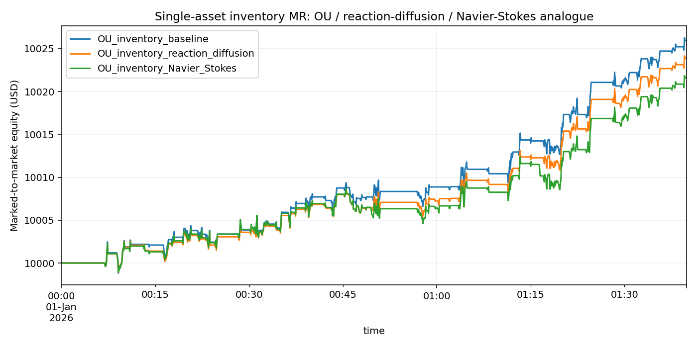

# Limit Order Book Dynamics: A 1D Navier-Stokes Analogue 🌊📉


[](LICENSE)


An experimental study of limit order book (LOB) dynamics. It compares a **1D isothermal compressible Navier–Stokes analogue** and a **reaction–diffusion PDE** as ways to forecast near-book depth imbalance. Both forecasts feed into the same Ornstein–Uhlenbeck (OU) mean-reversion and inventory framework.

> **TL;DR:** The OU baseline earned the highest net P&L in this synthetic run. Adding a fluid model made the strategy more complex without improving its result on this data.

## 📊 The Result: When Physics Meets Market Microstructure

Marked-to-market equity for three inventory-managed strategies on **1,200 synthetic L2 snapshots**, sampled five seconds apart (seed 24). Each starts with USD 10,000 and a USD 1,000 position cap.



| Model | Net P&L | Executions | Max Drawdown |
|---|---:|---:|---:|
| **OU + inventory (baseline)** | **+$25.93** | 171 | −0.0364% |
| OU + inventory + reaction–diffusion | +$23.85 | 165 | −0.0327% |
| OU + inventory + Navier–Stokes | +$21.58 | 187 | −0.0409% |

See [the full results](summary.csv) for return, turnover, and ending inventory. The synthetic price generator includes mean reversion, so the baseline has an advantage built into the experiment. This comparison does not isolate the cause of the performance gap or establish how the models would perform on real order books.

## 🧮 Mathematical Framework

### 1. 1D Compressible Navier–Stokes Analogue

In one dimension, an incompressible model forces velocity to be spatially constant. This experiment uses an isothermal compressible system, applied separately to bid and ask depth along the distance from the midprice ($x$ in basis points):

$$
\partial_t \rho + \partial_x(\rho u) = \lambda(\bar{\rho} - \rho)
$$

$$
\partial_t(\rho u) + \partial_x(\rho u^2 + c^2\rho)
= \partial_x(\nu\rho\,\partial_x u) - \eta\rho u
$$

- $\rho$ is the order book size per unit of price distance. The source term relaxes depth toward the reference profile $\bar{\rho}$ because posts, cancels, and fills can change total resting size.
- $u$ is a velocity proxy inferred from changes between snapshots. $p = c^2\rho$ is an assumed pressure law.
- The solver uses **Rusanov finite-volume fluxes**, reflecting boundaries, and adaptive CFL time stepping.

### 2. Reaction–Diffusion PDE Benchmark

An explicit finite-difference solver with reflecting boundaries smooths depth across price bins and relaxes it toward a historical reference profile.

For both PDE variants, the forecast adjusts expected return via near-book imbalance and limits the target inventory using forecast depth. The backtest executes the previous observation's signal at the next observed bid or ask with assumed fees and slippage.

## 🚀 Quick Start

From the repository root, install the demo dependencies and run:

```bash
python -m pip install numpy pandas matplotlib
python inventory_mr_navier_stokes.py --self-test
python inventory_mr_navier_stokes.py --demo --seed 24 --n 1200 --ns-horizon 5 --out inventory_mr_ns_results
```

The demo runs offline after installation and requires no API keys. It writes `summary.csv`, `equity_comparison.png`, model-level features, equity and trade CSVs, and `config.json` into the output directory.

To collect and replay **public** order book snapshots (internet required for collection only):

```bash
python -m pip install ccxt
python inventory_mr_navier_stokes.py --collect --seconds 3600 --interval 5 --out snapshots_data
python inventory_mr_navier_stokes.py --snapshots snapshots_data/orderbook_snapshots.jsonl --ns-horizon 5 --out replay_results
```

The `--fetch` and `--csv` modes use OHLCV data and run only the OU baseline because OHLCV does not contain L2 depth.

## 🔬 Limitations and Next Steps

Snapshot changes cannot identify quote velocity, individual order events, or queue position. The depth models use assumed parameters and the backtest uses simplified execution. A next step is to calibrate against synchronized event-level L2 and trade data, then compare depth forecast error and net strategy performance against the baseline on separate sessions.

This project is a research simulation. It does not place live orders, and synthetic P&L is not evidence of expected live returns.

Background: Cont & Müller (2021), [*A Stochastic Partial Differential Equation Model for Limit Order Book Dynamics*](https://doi.org/10.1137/19M1254489).

## 📄 License

Licensed under the [Apache License 2.0](LICENSE).
